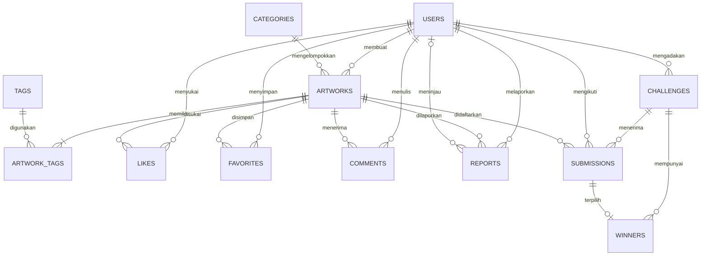

# Rancangan database

Guest tidak mempunyai baris akun. Peran akun tersimpan di users; curator_status hanya diisi untuk Curator.

## Keputusan desain

- **Relasi tags:** tabel artwork_tags menghubungkan banyak karya dengan banyak tag, tanpa menyimpan daftar koma di satu kolom. Minimal satu tag divalidasi dalam transaksi pada modul karya Hari 4; ERD menggambarkan aturan bisnis tersebut.
- **Submisi milik peserta:** foreign key gabungan (artwork_id, member_id) memastikan karya dimiliki peserta. UNIQUE(challenge_id, member_id) membatasi satu karya per peserta.
- **Pemenang:** foreign key gabungan memastikan submisi berasal dari challenge yang sama. Rank hanya 1–3, unik per challenge; submission_id unik agar satu karya tidak memperoleh dua peringkat dalam challenge.
- **Kategori:** indeks unik lower(name) mencegah Fotografi dan fotografi menjadi dua kategori. Kategori yang dipakai karya tidak dapat dihapus sebelum karya dipindahkan.
- **Waktu:** timestamptz menyimpan momen absolut. Antarmuka nanti memakai Asia/Makassar (WITA). Aktif berarti starts_at <= now() dan now() < ends_at; pemilihan pemenang baru boleh saat now() > ends_at.
- **Laporan:** dismissed tetap disimpan sehingga peserta tidak bisa melaporkan ulang karya sama. Take down menghapus karya dan relasi laporannya. Hari 6 menerapkan transaksi moderasi.
- **Penghapusan:** akun Member menghapus karya dan interaksinya melalui CASCADE; Curator menghapus challenge beserta submisinya. Penghapusan berkas fisik perlu ditangani aplikasi pada modul terkait. Admin tidak dapat dihapus lewat aplikasi; pengecekan peran dibuat Hari 3.
- **File karya:** trigger menolak perubahan file_path dan media_type saat edit.
- **Seed:** ON CONFLICT DO NOTHING menghindari duplikasi saat dijalankan ulang; seed tidak mengatur ulang perubahan pengguna atau menggeser waktu challenge lama. Semua contoh masuk dalam satu transaksi.

## Pembagian validasi

Constraint database sudah menjaga foreign key, keunikan, isi dasar, dan urutan tanggal. Otorisasi peran, validasi upload, minimal tag, larangan melaporkan karya sendiri, serta batas waktu submit/withdraw/pemenang akan diperiksa kembali di backend pada tahap fitur masing-masing. Skema Hari 1 bukan sistem otorisasi lengkap.

Untuk menangani permintaan bersamaan saat challenge berubah, backend challenge nanti mengunci baris challenge dengan SELECT ... FOR UPDATE dalam transaksi, lalu memeriksa waktu serta kepemilikan sebelum menulis.

